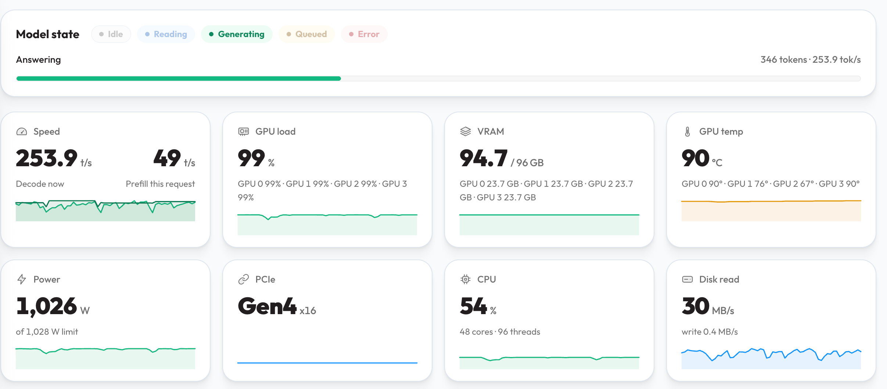

# 基于 Strata 的多显卡多并发改造:4× RX 7900 XTX 数据并行 + 共享专家池部署实录

> 建议仓库名:`strata-multi-gpu-deploy`(或 `strata-4x7900xtx-parallel`)

在 4 张 RX 7900 XTX + **单颗** AMD EPYC 7K62(48 核 96 线程)+ 128GB 内存的"穷人顶配"上,把 [Strata](https://github.com/Niko1221/Strata)(Qwen3.8-Flash-Next 125B MoE 本地推理,**unsloth UD-IQ4_XS 量化**,详见[模型与精度](#模型与量化精度))从官方默认配置改造成 **4 路真并发、聚合 188.6→200+ tok/s(满载实测,瞬时峰值 253.9)、256K 上下文**——专家权重在内存里只放**一份**,四张卡按需取用。

> English summary at the bottom. / [English intro](#english-summary)

## 这个仓库是什么,不是什么

**是**:基于上游 [Strata](https://github.com/Niko1221/Strata) 的**部署配置改造与调优实录**。最终方案**零引擎代码改动**,全部通过 Strata 自带的配置项(`replicas`、`--shared-expert-arena`、`STRATA_ARENA_PIN_GIB`)组合实现,外加一个被实测定位、已准备好上报上游的 ROCm 缺陷及其旁路。

**不是**:Strata 的 fork。引擎二进制就是上游 0.1.45(commit 477ac13),本仓库不改它的源码、不跟它的发布节奏耦合,`update.sh` 升级上游后本仓库的配置依然适用(参数语义由上游定义)。

## 模型与量化精度

| 项 | 值 |
|---|---|
| 模型 | Qwen3.8-Flash-Next,125B 稀疏 MoE:24,576 个路由专家,每 token 仅激活 10 个 |
| 量化版本 | **unsloth UD-IQ4_XS**(unsloth 官方动态 i-quant,GGUF,整体 ~4-bit 档) |
| 下载体积 | **93.7 GB**,3 个分片(国内走 ModelScope 实测 ~40MB/s) |
| 专家池大小 | **59.5 GB**(解压后驻留内存的专家权重;本方案全机只放一份,4 卡共享) |
| 质量档位 | 介于 IQ3_S 与 UD-Q4_K_XL 之间(unsloth 官方定位,IQ3_S 档在公开基准已能对齐全精度) |
| KV / 上下文 | `--kv int8`:每 token 仅 13.4KB,单路 256K 上下文;4 路合计 ~14GB 内存 |
| 附加能力 | 视觉编码器随包提供(在 CPU 上跑);自带 MTP 投机解码草稿层(`--spec 4 --mtp`) |

**UD-IQ4_XS 是什么**:unsloth 的动态量化方案——按层重要性分配位宽(专家门控/上投影用 IQ3_S,下投影用 IQ4_NL/Q8_0,稠密侧对齐 UD-Q4_K_XL),整体体积落在 ~4-bit 档,质量优于固定 IQ3_S、略低于 UD-Q4_K_XL。

**为什么选它**:59.5GB 的专家池,是 128GB 内存里能同时容纳「一份全量共享池 + 4 路副本开销 + 操作系统」的最大档位——运行期全机内存占用约 79GB,刚好放得下;再选高一档量化,池子就塞不进共享内存,整个"一份池"架构不成立。换句话说,**这份量化方案和这套内存架构是互相选中的**。

## 为什么要改(动机,全部有实测数字)

| 官方默认/常见配置的问题 | 实测 |
|---|---|
| 单引擎 4 卡层切分:单流快,但**整机只有一条流水线**,多请求全排队 | 单流 63.5,第二个请求起只能等 |
| `--parallel` 批槽并发:此负载下**负优化** | 聚合只有 44.4(比单流还低) |
| 常规多副本(replicas):每副本**各自复制一份内存专家池**,128GB 撑不起 4 路 | 4×私有预算直接内存墙(5.9 tok/s) |

目标:4 张卡各自独立服务一路请求(**真 4 并发**),同时 128GB 内存里只放**一份** 56GB 专家池(**省内存**)。结果:对照口径聚合 188.6 tok/s(现行配置满载 ~200,见下节),是官方默认单流的 **3 倍**、默认配置并发能力的 **4.6 倍**。

改造过程中还定位并绕过了一个 ROCm 缺陷(多进程大范围 `hipHostRegister` 崩溃,详见 [docs/ROCM-SHARED-ARENA.md](docs/ROCM-SHARED-ARENA.md)),这部分的完整证据链对任何多卡 ROCm 用户都有参考价值。

## 最终架构(全部实测)

```
客户端 → http://<服务器IP>:8080(自动路由到最空闲的一路)
          ├─ 副本1(GPU0)─ 显存 ~16GB 热专家缓存 + 16GB 零拷贝注册
          ├─ 副本2(GPU1)─      ……
          ├─ 副本3(GPU2)─  共享:56GB 专家池(MAP_SHARED,全机一份)
          └─ 副本4(GPU3)─        + 每路 12 个独占物理核 + 256K 独立 KV
```

| 架构(中文小说负载,2000 token/请求) | 每路 tok/s | 聚合 tok/s |
|---|---|---|
| **4 副本 + 共享池 + 16GB 注册 + 调优(本仓库现行)²** | 48.7~64.9 | **~200 持续 / 253.9 瞬时** |
| 4 副本 + 共享池 + 限量注册(同口径对照¹) | 45.6~52.4 | 188.6 |
| 4 副本 + 8GB 私有预算 + 页缓存 | 24~30 | 102.3 |
| 2 副本(2卡/路)+ 25GB 私有预算 | 51~53 | 101.8 |
| 单引擎 4 卡层切分(纯单流最优) | 63.5 | 63.5 |
| parallel=4 批槽 | 8~20 | 44.4(负优化,弃用) |
| 4 副本 + 共享池 + 全量注册 | —— | 崩溃(见下) |

> ¹ 其余架构均在同一压测口径下横向对比(限量注册 1GB 档、纯压测流),保证六种架构数字可比。
> ² 现行配置(16GB 注册 + `--prefill auto:32768` + `--spec-min-p 0.7`)的满载实测:1 路真实 Codex 任务 60.1~64.9 + 3 路压测流 48.7/51.8/48.8,详见下节。

## 满载 4 路实测(定档 16GB + 调优后)

压测设计:先保留 1 路真实工作负载(Codex 代码会话,缓存全暖),再叠加 3 路压测流,把 4 张卡全部打满:

| 流 | 类型 | 速度 |
|---|---|---|
| 流 1 | 真实 Codex 任务(暖态) | **60.1~64.9 tok/s** 持续(监视器瞬时 85+) |
| 流 2~4 | 压测流(冷启动叠加) | 48.7 / 51.8 / 48.8 tok/s |
| **聚合** | | **持续 ~200 tok/s;监视器瞬时峰值 253.9** |



*(监视器实拍:4 卡全部 99%,显存 94.7/96GB,"Decode now" 瞬时 253.9 tok/s,功耗读数 1026/1028W 顶到上限档,热点温度 67~90°C)*

让真实任务比压测流还快的原因是**暖缓存**:它的热门专家已在显存里,压测流是冷启动,各自还在从共享池往显存搬各自的专家子集——这正是"显存热缓存 + 共享池冷备"分层设计想要的效果。

### 满载前的三个调优项(已并入 `scripts/04-enable-shared-arena.sh`)

| 调优 | 值 | 实测效果 |
|---|---|---|
| 预填分段 `--prefill auto:32768` | 默认无 | ~35K token 长提示词预填 694→785 tok/s(**+13%**),长上下文多轮会话受益最大 |
| 投机解码门槛 `--spec-min-p 0.7` | 默认 0.5 | MTP 草稿接受率实测 53%~83%,单流暖态 60~65、瞬时 85+ tok/s |
| 前缀缓存 | 默认开启 | **跨重启持久**:38.8K token 的重复提示词,引擎重启后再请求,预填仅 1.3 秒 |

> 满载功耗 ~1kW 已顶到这台机器的供电档位,长期满载请确认机箱风道与供电余量;90°C 是受限功耗下的热点温度,仍在规格内但已接近,注意定期除尘。

## 关键发现:ROCm 大范围 hipHostRegister 是 4 路共享池的崩点,也是解法所在

**问题**:4 个引擎共享一份 56GB 池、每进程全量注册(`hipHostRegister`)时,注册返回"成功"但 ROCm 运行时内部状态已损,启动尾声确定性集体 SIGSEGV(1~2 进程完全正常)。反汇编定位:内部映射描述符表指针为 NULL 仍被写标志位。

**根因**:AMD 官方将大范围 `hipHostRegister` 标记为永久性限制(ROCM-29767"Performance and Kernel Stability Limitations with Large Registrations";TheRock #8939 同款"注册成功但状态已损"签名)。

**解法(一个环境变量,零改码)**:

```json
"env": {"STRATA_ARENA_PIN_GIB": "16"}
```

每进程只向 GPU 注册 16GB(阶梯实测:1GB=46.9 稳、4GB=53.2 稳、**16GB=51.3 稳**、25GB 崩),其余 40GB 照常 mlock 驻留——CPU 专家池读内存**不需要**注册,GPU 侧由显存缓存+注册窗覆盖。相比 1GB 档提速 8~13%,4 路全稳。注意 16GB 档启动装载约 8~10 分钟(每进程钉 400 万页),属正常。

完整取证(反汇编、排除矩阵、注册尺寸实验)见 [docs/ROCM-SHARED-ARENA.md](docs/ROCM-SHARED-ARENA.md);已整理成上游 issue 模板,欢迎去 Strata 仓库顶帖。

## 快速部署

```bash
# 1. 系统准备(Ubuntu 22.04/24.04,内核 amdgpu 驱动,无需系统级 ROCm)
bash scripts/01-prepare-system.sh

# 2. 安装 Strata(克隆/编译/模型下载,免交互;国内网络已适配,见下节)
STRATA_HOST=0.0.0.0 bash scripts/02-install-strata.sh

# 3. 切换到 4 副本 + 共享专家池架构(本文档的主角)
bash scripts/04-enable-shared-arena.sh

# 4. 验证
bash scripts/03-verify.sh
```

网络适配(中国大陆实测):模型走 ModelScope(`STRATA_SOURCE=modelscope`,实测 ~40MB/s)、PyPI 走阿里/清华镜像、ROCm TheRock 轮子直连(实测 2~5MB/s)、GitHub 慢时仓库可从任意快机 rsync 过去。详见脚本内注释。

## 运维要点

- **服务器重启后必须**:`sudo mount -o remount,size=70G /dev/shm && sudo systemctl restart strata`(tmpfs 重置,共享池自动重建;16GB 注册档首启约 **8~10 分钟**,勿误判卡死)
- `--shared-expert-arena` 与 `--resident-budget-gib` 互斥;无预算标志 = 完整池
- 内核参数(iommu=pt、ttm.pages_limit、amdgpu gttsize)保留无害
- 版本锚点:Strata 0.1.45(477ac13)/ ROCm TheRock 7.14.0a20260612(gfx110X-all)/ Ubuntu 24.04.5
- 长提示词/多轮会话负载已并入 `--prefill auto:32768` 与 `--spec-min-p 0.7`(实测见「满载 4 路实测」一节);前缀缓存跨重启有效
- 并发压测脚本:`python3 scripts/concurrency-test.py 4`

## 硬件账本(为什么这么配)

- 专家池 59.5GB:4×24GB 显存摊不下单卡,但"4 卡显存缓存 + 一份 56GB 共享内存主本"刚好全覆盖
- KV 只有 12+1 层(其余 36 层是 DeltaNet 循环状态):每 token 仅 13.4KB,4×256K 上下文只吃 14.4GB 内存
- CPU 专家池 ~15 worker 饱和,48 物理核 ÷ 4 路每路 12 核,仅损失 5~10%
- 内存 8 通道只插 4 条 = 带宽腰斩;补 4 条既翻带宽又解锁更富余的共享池

## English summary

**Multi-GPU, multi-stream deployment recipes on top of upstream [Strata](https://github.com/Niko1221/Strata)** — a configuration-level rework (no engine fork; final solution is zero engine-code change) that turns the stock single-pipeline setup into **4 truly concurrent inference lanes on 4× RX 7900 XTX + one EPYC 7K62 + 128 GB RAM**: 4 data-parallel engines sharing ONE 56 GB expert pool in RAM (MAP_SHARED + pack-hash-checked `--shared-expert-arena`), 4 concurrent streams at 45–52 tok/s each, **188.6 tok/s aggregate in the architecture bake-off, ~200 tok/s sustained (253.9 tok/s instantaneous) at full load** after prefill/speculative-decoding tuning (3× the stock single-stream), 256K context. Model: Qwen3.8-Flash-Next 125B MoE in **unsloth UD-IQ4_XS** (~4-bit dynamic i-quant, 93.7 GB download, **59.5 GB expert pool** — the largest tier that fits one shared pool + 4 replicas into 128 GB RAM; quality between IQ3_S and UD-Q4_K_XL), int8 KV, MTP speculative decoding. Why rework: the stock layer-split serves one request at a time (63.5 tok/s), batch slots are a net negative here (44.4), and naive replicas hit a RAM wall (each replica duplicates the expert pool). Key finding along the way: whole-arena `hipHostRegister` across 4 processes deterministically SIGSEGVs inside libamdhip64 (a documented permanent ROCm limitation for very large registrations); capping registration via `STRATA_ARENA_PIN_GIB` (1/4/16 GiB tested stable; we ship 16 GiB) is a zero-code workaround. Full evidence, benchmarks for six architecture variants, China-network install cookbook, and ops notes inside. Versions: Strata 0.1.45 (upstream, unmodified), TheRock ROCm 7.14.0a20260612, Ubuntu 24.04.5.

## License

MIT. Benchmark numbers are from our specific box (see "版本锚点"); your mileage will vary — measure on your own hardware.
